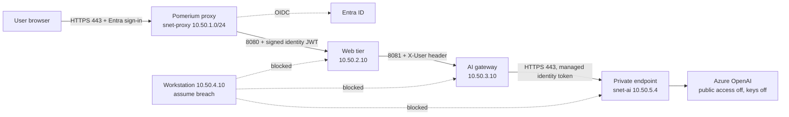
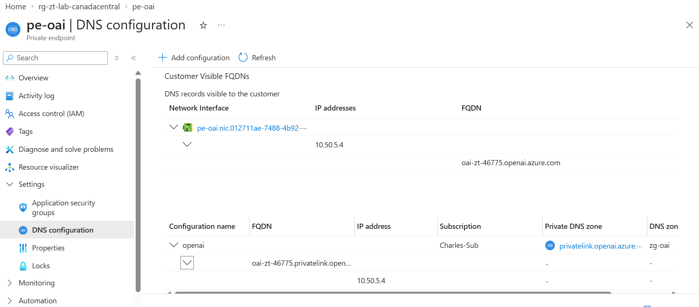
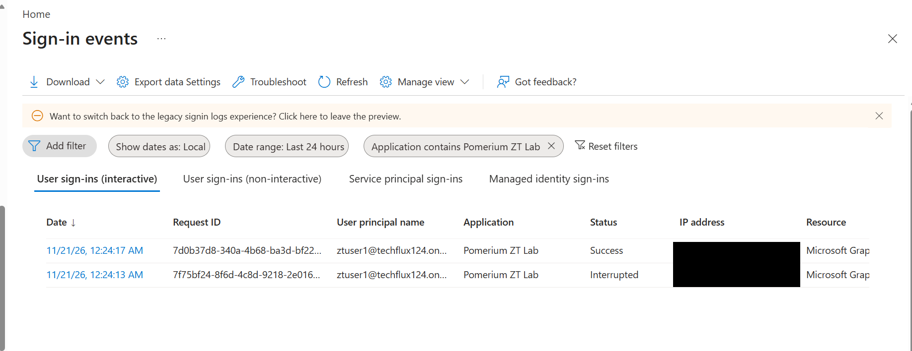
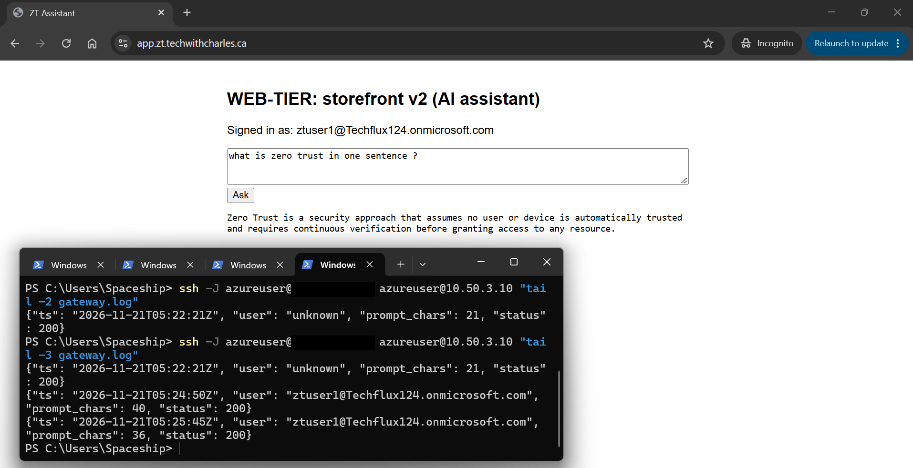
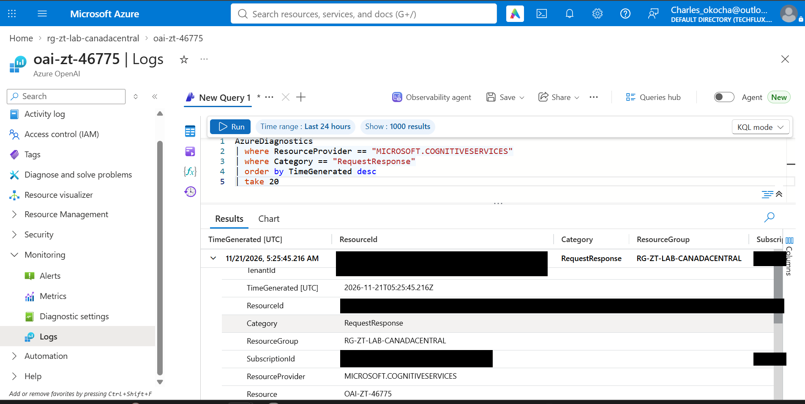
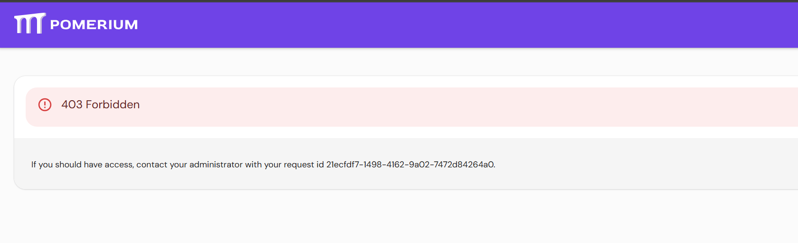

# Lab 06: Zero Trust on Azure, with Azure OpenAI

This lab is my attempt at a real Zero Trust setup on Azure. Users reach the application only through an identity-aware proxy. Each tier can only talk to the one tier it needs. And I treat one workstation inside the network as already compromised, then check that it can't get anywhere.

Then I added Azure OpenAI to the mix. The model can be called by exactly one workload identity, over a private endpoint, with no API keys and no public path.

I built and tested all of this in November 2026. It's meant to be disposable: I deallocated the VMs whenever I wasn't working and delete the whole resource group when I'm done, so the cost stays low.

## The three Zero Trust principles, and where each one is proven

| Principle | How the lab enforces it | Evidence |
|---|---|---|
| Verify explicitly | Pomerium checks every request against an Entra identity and an email policy. The model API only accepts Entra tokens from one managed identity. | Pomerium `authorize check` log lines, Entra sign-in log, OpenAI request log |
| Least privilege | One role (Cognitive Services OpenAI User) on one resource for one identity. Each NSG allows only the single flow its tier needs. | IAM screenshot, NSG rule table, flow tests |
| Assume breach | A workstation inside the VNet is treated as hostile. It can't reach the web tier, the app tier or the model endpoint, and it can't get a token. | `http=000` timeouts, `Identity not found`, sweep before and after |

## Architecture



- VNet `10.50.0.0/16` in Canada Central.
- `snet-proxy` 10.50.1.0/24: Pomerium in Docker with a Let's Encrypt certificate. Ports 80 and 443 are open to the internet.
- `snet-web` 10.50.2.0/24: the web tier (Python, port 8080). Only the proxy can reach it.
- `snet-app` 10.50.3.0/24: the AI gateway (Python, port 8081). Only the web tier can reach it. This VM holds the managed identity.
- `snet-wks` 10.50.4.0/24: the workstation I treat as breached.
- `snet-ai` 10.50.5.0/24: the private endpoint for Azure OpenAI.
- Every VM is a Standard_B2s running Ubuntu 22.04. SSH goes through the proxy as a jump host, and only from my home IP.

## NSG rules: deny by default inside the VNet

Azure's built-in `AllowVnetInBound` rule (priority 65000) lets everything in a VNet talk to everything else. I override it on every subnet with an explicit `Deny-VNet-Inbound` at priority 4000, and put a specific allow above it for each flow that's actually needed.

| NSG | Priority | Rule | Allows |
|---|---|---|---|
| nsg-proxy | 100 | Allow-SSH-Home | home IP /32 to 22 |
| nsg-proxy | 110 | Allow-Web-Internet | Internet to 80, 443 |
| nsg-proxy | 120 | Allow-HTTPS-From-Workstations | 10.50.4.0/24 to 443 |
| nsg-proxy | 4000 | Deny-VNet-Inbound | |
| nsg-web | 100 | Allow-Proxy-To-Web | 10.50.1.10 to 8080 |
| nsg-web | 110 | Allow-SSH-From-Proxy | |
| nsg-web | 4000 | Deny-VNet-Inbound | |
| nsg-app | 100 | Allow-Web-To-App-API | 10.50.2.10 to 8081 |
| nsg-app | 110 | Allow-SSH-From-Proxy | |
| nsg-app | 4000 | Deny-VNet-Inbound | |
| nsg-wks | 100 | Allow-SSH-From-Proxy | |
| nsg-wks | 4000 | Deny-VNet-Inbound | |
| nsg-ai | 100 | Allow-App-To-OpenAI | 10.50.3.10 to 443 |
| nsg-ai | 4000 | Deny-VNet-Inbound | |

## Phase 1: Microsegmentation, before and after

I wrote a small sweep script that runs on the workstation. It probes every tier on ports 22, 80, 443, 5432, 8080 and 8081 using `timeout 2 bash -c "echo > /dev/tcp/$h/$p"`, and labels each result OPEN, closed, or FILTERED (a timeout).

- **Before** (Azure defaults): the workstation could reach the other tiers and read a planted fake customer record from the app tier.
- **After** (explicit deny plus per-flow allows): every probe from the workstation to every tier timed out, except `10.50.1.10:443`. That one answered "closed", meaning the port was reachable but nothing was listening yet.
- **Flow tests:** I ran five. The two permitted flows returned HTTP 200 and the three forbidden ones timed out (`000`).

## Phase 2: Identity-aware access with Pomerium

Pomerium runs all-in-one on the proxy VM. It uses Entra ID as the OIDC provider and gets its certificate from Let's Encrypt (HTTP-01).

Sanitised config:

```yaml
authenticate_service_url: https://auth.zt.example.com
address: :443
http_redirect_addr: :80
autocert: true
autocert_dir: /pomerium/autocert
shared_secret: <generated>
cookie_secret: <generated>
idp_provider: azure
idp_provider_url: https://login.microsoftonline.com/<tenant-id>/v2.0
idp_client_id: <app-registration-client-id>
idp_client_secret: <entered via read -rsp, never pasted anywhere>
routes:
  - from: https://app.zt.example.com
    to: http://10.50.2.10:8080
    pass_identity_headers: true
    policy:
      - allow:
          or:
            - email:
                is: ztuser1@<tenant>.onmicrosoft.com
```

Started with: `docker run -d --name pomerium --restart unless-stopped -p 80:80 -p 443:443 -v ~/pomerium/config.yaml:/pomerium/config.yaml:ro -v ~/pomerium/autocert:/pomerium/autocert pomerium/pomerium:latest`

What happened:

- Internet scanners found the new hostname within seconds of the certificate being issued, because certificate transparency logs advertise every new cert. Every one of them was logged as `user-unauthenticated` and got nothing back.
- A signed-in user who isn't on the policy gets a Pomerium 403, logged as `email-unauthorized`.
- If the email claim is empty, Pomerium fails closed.
- MFA came from Entra Security Defaults. I didn't create a Conditional Access policy (more on that under Limitations).

## Phase 3: The AI tier

The web tier now serves a small chat page. A signed-in user types a question, and it goes from the web tier to the AI gateway on the app tier and then to Azure OpenAI. The gateway authenticates with its managed identity, so there is no key anywhere in the system.

### How the Azure OpenAI resource is locked down

| Control | Setting |
|---|---|
| Custom subdomain | Required for private endpoints and Entra token auth |
| Public network access | Disabled |
| Local (key) authentication | Disabled |
| Trusted Azure services exception | Unticked, so there's no implicit trust |
| Private endpoint | `pe-oai` in `snet-ai`, with the private DNS zone `privatelink.openai.azure.com` linked to the VNet |
| Subnet network policies | `--private-endpoint-network-policies Enabled`, so the NSG is actually enforced on the endpoint |
| Data-plane role | Cognitive Services OpenAI User, scoped to this one resource, held only by the app VM's system-assigned managed identity |
| Logging | Audit and RequestResponse to a Log Analytics workspace (capped at 1 GB per day) |
| Model | `gpt-5.4-nano`, Global Standard deployment |

### Before and after, tested from my home internet

| Test | Result |
|---|---|
| API key, defaults (before) | The model replied |
| API key, keys disabled, public access still on | HTTP 403 `AuthenticationTypeDisabled` |
| API key, keys briefly re-enabled, public access off | HTTP 403 "Public access is disabled. Please configure private endpoint." |
| API key, keys disabled again, public access off | HTTP 403 `AuthenticationTypeDisabled` |

The service checks the key before it checks the network, so my first test with public access off only showed the key error. To prove the network control on its own, I turned keys back on for a minute, confirmed the call was blocked on the network, then turned keys off again.

### The working path, and the breach tests

| From | Test | Result |
|---|---|---|
| App VM | Get a token from the managed identity, call the model | The model replied |
| App VM | HTTPS to the endpoint | HTTP 200 (allowed by `Allow-App-To-OpenAI`) |
| Workstation | HTTPS to the endpoint | `http=000`, dropped by `nsg-ai` |
| Web VM | HTTPS to the endpoint | `http=000`, dropped by `nsg-ai` |
| Workstation | Ask for a managed identity token | `Identity not found` |

All three VMs resolve the model's hostname to the same private IP (10.50.5.4). DNS answers for the whole VNet, so being able to resolve a name doesn't give anyone access. What protects the model is the NSG and the need for an identity.



*The private endpoint `pe-oai` and its DNS record. The model's hostname resolves to 10.50.5.4 inside the VNet.*

### The audit trail

The OpenAI log only sees the app VM's managed identity, not the person using the chat page. The gateway is where the person gets attributed, so the full picture is a join across four logs:

1. **Entra sign-in log:** who authenticated to Pomerium, and when.
2. **Pomerium log:** every request with the user's email, session ID and allow or deny decision.
3. **Gateway log:** which user triggered each model call (user, timestamp, prompt length and status; the prompt text is never logged).
4. **OpenAI RequestResponse log:** the model call itself, with the caller's subnet (`10.50.3.**`), the status, and the managed identity's object ID in `properties_s`.

Control-plane access gets logged too. Opening Keys and Endpoint in the portal produced `Audit / ListKey` events, even though keys are disabled.

Here is the trail for one chat question. Times are the same event seen in three places (the portal shows local time, the logs show UTC, five hours apart).



*Entra sign-in log, filtered to the Pomerium app. The sign-in succeeded at 12:24:17 AM local (05:24 UTC). I blacked out the IP column.*



*The chat page and the gateway log. The first entry says `unknown` because that call carried no identity header. The two after it, from the chat page, name the user.*



*The OpenAI RequestResponse log recorded the model call at 05:25:45 UTC, the same second as the last gateway entry. IDs are blacked out.*

### What happens when you revoke someone

1. Removing the user's assignment on the Entra enterprise app blocked a new sign-in right away with `AADSTS50105` ("not a direct member of a group with access, nor had access directly assigned").
2. A browser session that was already signed in kept working after I removed the assignment. The model answered a new question. I only saw this once, so I didn't measure how long such a session lasts.
3. Changing the Pomerium policy (editing the allowed email and letting Pomerium reload its config file, no restart) turned that same live session into a Pomerium 403 within about 15 seconds. Pomerium evaluates its policy on every request.



*The same live session after I changed the Pomerium policy. The request ID is what an administrator would search for in the Pomerium log.*

So removing someone in the identity provider stops new sign-ins immediately, but sessions that already exist live until they expire. If you need fast revocation, change the Pomerium policy, keep session lifetimes short, or use continuous access evaluation.

## What I learned

1. **Azure OpenAI ships wide open.** The public endpoint and API keys are on by default. Locking it down takes four separate settings (custom subdomain, private endpoint, public access off, keys off) plus an RBAC role.
2. **Error order can hide a control.** The service rejected the key before it looked at the network setting, so one test couldn't prove both. Test each control on its own.
3. **An NSG on a private endpoint subnet does nothing unless network policies are enabled** on that subnet. Without that flag the workstation would have connected.
4. **The trusted services exception was ticked by default**, even with public access disabled. I removed it because I don't use any trusted service.
5. **Regional Standard deployments weren't available in Canada Central.** Only Global and Provisioned were. The model runs as Global Standard, which may process requests outside Canada. That's fine for fake lab data, but a real deployment would need a residency decision.
6. **Diagnostic settings take a while to switch on.** The first RequestResponse row showed up about 11 minutes after I created the setting, so the earlier calls weren't logged.
7. **The user's identity never reaches the model service.** The gateway is the place where a person is tied to a request.
8. **Scanners show up within seconds of a new public certificate.** Anything listening on 443 needs a policy from the very first moment.

Mistakes that cost me time:

- I once started Pomerium and Docker on the wrong VM because of a stale SSH session. Check the hostname in the prompt before running anything.
- A client secret has a Value (about 40 characters) and a separate Secret ID (a GUID). Using the wrong one fails quietly.
- Let's Encrypt rate-limits failed authorizations to 5 per hour per identifier, so one misdirected attempt locks you out for an hour.
- Signed Pomerium links expire in about 5 minutes.
- Rewriting a bind-mounted config file with `sed -i` replaces its inode, and the container keeps reading the old copy. Edit the file in place instead.
- `pkill -f` can match its own shell if the pattern appears in the command line. Use the bracket trick (`[g]ateway.py`) or split it into separate commands.
- Shell variables disappear when you open a new PowerShell window. A missing variable gave me an endpoint of `https://.openai.azure.com` and a 502.
- On Windows PowerShell 5.1, `curl.exe` and `az` only exist in PowerShell, not inside SSH sessions. Home public IPs rotate, so recheck yours before trusting an NSG rule scoped to one.

## What this lab doesn't prove

- **No Conditional Access.** Entra enforcement came from Security Defaults, which can't be combined with Conditional Access. A Conditional Access policy in report-only mode, with a break-glass exclusion, is follow-up work here. Conditional Access policies are covered separately in Lab 04 of this repo.
- **Blocked flows are shown by client-side timeouts and the NSG configuration**, not by VNet flow logs.
- **The web tier decodes Pomerium's identity JWT without verifying its signature.** That's only acceptable here because the NSG lets nothing but the proxy reach that tier. A production service has to verify the signature against Pomerium's published keys.
- **The Python servers are single-threaded demos**, with no TLS between tiers.
- **I saw the revocation behaviour once**, and didn't measure how long a live session lasts.
- **Global Standard residency**, as described above.

## Reproduce the AI tier

```powershell
# resource providers (first use in a subscription)
az provider register --namespace Microsoft.CognitiveServices
az provider register --namespace Microsoft.OperationalInsights

# dedicated subnet and NSG for the private endpoint
az network nsg create -g <rg> -n nsg-ai -l canadacentral
az network nsg rule create -g <rg> --nsg-name nsg-ai -n Allow-App-To-OpenAI --priority 100 --direction Inbound --access Allow --protocol Tcp --source-address-prefixes 10.50.3.10/32 --destination-address-prefixes "*" --destination-port-ranges 443
az network nsg rule create -g <rg> --nsg-name nsg-ai -n Deny-VNet-Inbound --priority 4000 --direction Inbound --access Deny --protocol "*" --source-address-prefixes VirtualNetwork --destination-address-prefixes VirtualNetwork --destination-port-ranges "*"
az network vnet subnet create -g <rg> --vnet-name vnet-zt -n snet-ai --address-prefixes 10.50.5.0/24 --network-security-group nsg-ai --private-endpoint-network-policies Enabled

# logging
az monitor log-analytics workspace create -g <rg> --workspace-name law-zt-lab -l canadacentral --retention-time 30 --quota 1

# OpenAI resource and model
az cognitiveservices account create -g <rg> -n <unique-name> -l canadacentral --kind OpenAI --sku S0 --custom-domain <unique-name> --yes
az cognitiveservices account deployment create -g <rg> -n <unique-name> --deployment-name chat-nano --model-name gpt-5.4-nano --model-version 2026-03-17 --model-format OpenAI --sku-name GlobalStandard --sku-capacity 10

# private endpoint and DNS
az network private-endpoint create -g <rg> -n pe-oai -l canadacentral --vnet-name vnet-zt --subnet snet-ai --private-connection-resource-id <account-id> --group-id account --connection-name pec-oai
az network private-dns zone create -g <rg> -n privatelink.openai.azure.com
az network private-dns link vnet create -g <rg> --zone-name privatelink.openai.azure.com -n link-vnet-zt --virtual-network vnet-zt --registration-enabled false
az network private-endpoint dns-zone-group create -g <rg> --endpoint-name pe-oai -n zg-oai --private-dns-zone privatelink.openai.azure.com --zone-name openai

# identity and least privilege
az vm identity assign -g <rg> -n vm-zt-app
az role assignment create --assignee-object-id <principal-id> --assignee-principal-type ServicePrincipal --role "Cognitive Services OpenAI User" --scope <account-id>

# lock it down (keys off, then public access off)
az resource update --ids <account-id> --api-version 2024-10-01 --set properties.disableLocalAuth=true
az resource update --ids <account-id> --api-version 2024-10-01 --set properties.publicNetworkAccess=Disabled
# then untick "Allow Azure services on the trusted services list" in Networking and Save

# diagnostics
az monitor diagnostic-settings create --name diag-oai --resource <account-id> --workspace <law-id> --logs "@logs.json"
```

The app VM calls the model with a token from `http://169.254.169.254/metadata/identity/oauth2/token?api-version=2018-02-01&resource=https://cognitiveservices.azure.com`, sent as a bearer token to `https://<name>.openai.azure.com/openai/v1/chat/completions`.

## Teardown

The order matters. DNS records go first so nobody can claim a released public IP under my hostnames. Then the identity objects, then the resource group.

1. Delete the `auth.zt` and `app.zt` DNS records at the registrar.
2. Delete the Entra app registration (this also removes its secret and the enterprise app) and the test users.
3. Force-delete the Log Analytics workspace so it isn't left soft-deleted.
4. Run `az group delete --name <rg> --yes --no-wait`, then confirm `az group exists` returns false.
5. Azure AI resources are soft-deleted and keep their name reserved, so list and purge them: `az cognitiveservices account list-deleted`, then `az cognitiveservices account purge`.
6. Check that the budget alert is still in place.
